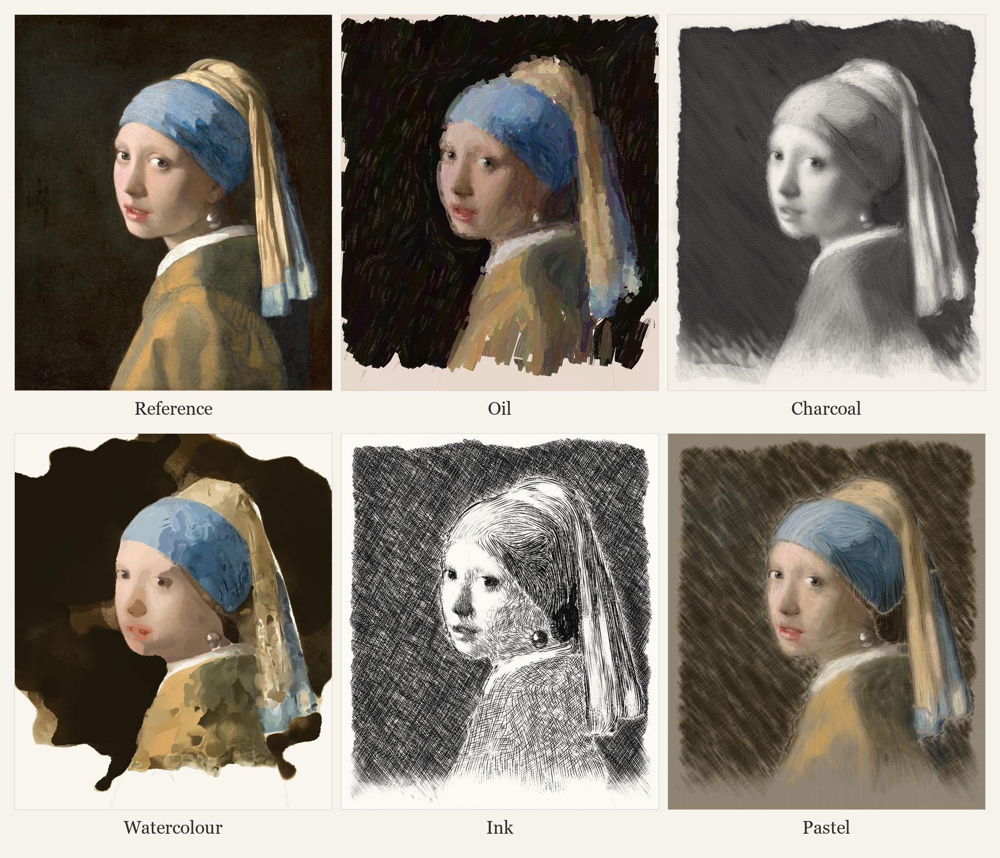

# Portrait Making

A skill for AI coding agents that paints a portrait from a reference image, the way an artist works: underdrawing, block-in, form, focal detail and a few last accents. It writes JavaScript with [p5.js](https://p5js.org) and [p5.brush](https://github.com/acamposuribe/p5.brush), so every stroke is drawn by code. It can also record the process as an MP4.




## Styles

| Style | Look |
|---|---|
| `oil` | Alla prima oil study with bristle brushwork and broken colour |
| `charcoal` | Graphite and charcoal on warm paper, checked against the photo after every pass |
| `watercolour` | Transparent washes on white paper, light to dark, with each mass in its own clean colour |
| `ink` | Pen and ink on white, like an engraving: evenly spaced lines that follow the form and swell with the value |
| `pastel` | Soft pastel on toned paper, from a box of sticks chosen for the sitter, with lights laid on top |

## Requirements

- Python 3 with Pillow and numpy: `pip install pillow numpy`
- [ffmpeg](https://ffmpeg.org) on your PATH (only for videos)
- An agent that can run shell commands and drive a visible browser. It must be able to run JavaScript in the page, for example through the Claude desktop app's browser pane, Claude in Chrome or [Playwright MCP](https://github.com/microsoft/playwright-mcp). Painting uses WebGL, which headless browsers may render slowly or not at all.
- Internet access in that browser, because the page loads p5.js and p5.brush from a CDN

## Install

Each option copies the `portrait-making` folder into a skills folder, so that `SKILL.md` ends up directly inside `skills/portrait-making/`.

### Claude Code, for all your projects

macOS or Linux:

```bash
git clone https://github.com/bingbangboom-lab/portrait-making.git
mkdir -p ~/.claude/skills
cp -r portrait-making/portrait-making ~/.claude/skills/
```

Windows (PowerShell):

```powershell
git clone https://github.com/bingbangboom-lab/portrait-making.git
New-Item -ItemType Directory -Force "$HOME\.claude\skills"
Copy-Item -Recurse portrait-making\portrait-making "$HOME\.claude\skills\"
```

### Claude Code, for one project

Run this from the project's root folder, after cloning as above:

```bash
mkdir -p .claude/skills
cp -r /path/to/portrait-making/portrait-making .claude/skills/
```

### OpenCode and other agents

`SKILL.md` isn't tied to one tool's commands. OpenCode can read skills from `.claude/skills/`, so the steps above should work there too. For another agent, copy the folder to wherever it keeps skills, or point it at `portrait-making/SKILL.md` and ask it to follow the instructions.

### Updating

Run `git pull` in your clone and copy the folder again.

## Use

Start a new session so the agent picks up the skill, then ask for a portrait:

> Paint a watercolour portrait of `photo.jpg` and render the process as a video.

The agent asks for anything you left out (style, video shape, music), measures the image, paints, critiques its own work and adjusts. Expect several minutes per style. A browser tab has to stay open while it works.

## Try the example

The template is already filled in for the painting shown above, so you can paint it without an agent. Stills and video capture need the agent's workflow in `SKILL.md`, but this lets you watch it paint:

```bash
cd portrait-making/template
python -m http.server 8123
```

Then open <http://127.0.0.1:8123/index.html?style=pastel>. Change `pastel` to any style in the table.

## What's in the repo

```
portrait-making/
  SKILL.md        the agent's instructions, including a critique checklist per style
  template/       the engine (painter.js), the page, and a worked example (subject.js)
  scripts/        measuring, capture, review and video tools
showcase/         the grid, one image per style, and a GIF of them being painted
```

## Credits

- The reference is *Girl with a Pearl Earring* by Johannes Vermeer (c. 1665), a public-domain painting.
- Built on [p5.js](https://p5js.org) and [p5.brush](https://github.com/acamposuribe/p5.brush).

## License

[MIT](LICENSE)
